# Hi, I'm Eberth Alarcón 👋

📍 Santiago, Chile · 🕐 UTC-4/-3

<!-- opcional: descomenta la siguiente linea si quieres senalar disponibilidad de forma publica -->
<!-- Open to remote opportunities in cybersecurity and AI security. -->

---

## 👨‍💻 About me

Cybersecurity engineer with 10+ years in IT, networks and infrastructure. My angle is applying traditional, battle-tested security discipline to the new attack surface of AI and LLM systems.

- 🏗️ Built and ran the full IT and security function for a ~60-person organization from the ground up
- 🤖 Designed and secured, as its sole engineer, an on-premises LLM voice agent
- 🐍 I write my own security tooling in Python
- 🌱 Currently preparing for **CEH v13**
- 💬 Ask me about AI/LLM security, pentesting or IoT security

 

## 🚀 Featured work

### 🔐 On-premises AI voice agent — sole engineer (2025–2026)

Fully local LLM voice pipeline over SIP/RTP (Faster-Whisper, Ollama, LangChain, Piper) in Docker, with no dependency on external AI services. Taken to preproduction on a GPU server.

- **The LLM has no tool access:** code, not the model, controls consent, data capture and actions
- **Layered guardrails:** prompt-injection detection, per-session canary tokens and output validation, mapped to the OWASP LLM Top 10, MITRE ATLAS and NIST AI RMF
- **Validated** with 800+ real calls, including adversarial ones, and 6,600+ automated tests

Company project: the source code is private.

### 📡 [Deauth-Alert](https://github.com/Eberth-sys/Deauth-Alert-WiFi-IoT-System) — Wi-Fi attack detection with IoT

ESP32 sensors detect 802.11 deauthentication attacks and report over encrypted BLE to a Raspberry Pi 5, with a FastAPI/PostgreSQL backend, TLS and Telegram alerts. Postgraduate thesis at Universidad de Buenos Aires, graded 10/10.

## 🛠️ Focus areas

- **AI/LLM security** — prompt-injection defense, canary tokens, output validation and excessive-agency controls
- **Pentesting & vulnerability management** — internal pentesting, CVSS-based prioritization and remediation
- **Identity & infrastructure** — Active Directory + Entra ID hybrid identity, MFA, GPO hardening, EDR, VLAN segmentation
- **Secure SDLC & governance** — threat modeling, security design reviews, incident response, ISO/IEC 27001 audit readiness
- **IoT security & Python tooling** — ESP32/Raspberry Pi systems and my own security scripts

## 🧰 Tech stack

## 🎓 Education & certifications

- **Postgraduate Specialization in IoT** — Universidad de Buenos Aires (UBA), thesis graded 10/10
- **Electronics Engineering, Telecommunications major** — URBE, Venezuela, graduated with honors
- **Diplomas in Cybersecurity Tools & Network Security** — Universidad de Santiago de Chile (USACH)
- **MikroTik Certified Security Engineer (MTCSE)** · **CEH v13** *(in progress)*

## 📈 GitHub activity

<picture>
  <source media="(prefers-color-scheme: dark)" srcset="https://streak-stats.demolab.com?user=Eberth-sys&hide_border=true&background=0D1117&stroke=30363D&ring=0A66C2&fire=58A6FF&currStreakNum=E6EDF3&sideNums=E6EDF3&currStreakLabel=58A6FF&sideLabels=8B949E&dates=8B949E">
  
</picture>

<picture>
  <source media="(prefers-color-scheme: dark)" srcset="https://raw.githubusercontent.com/Eberth-sys/Eberth-sys/output/github-snake-dark.svg">
  
</picture>

